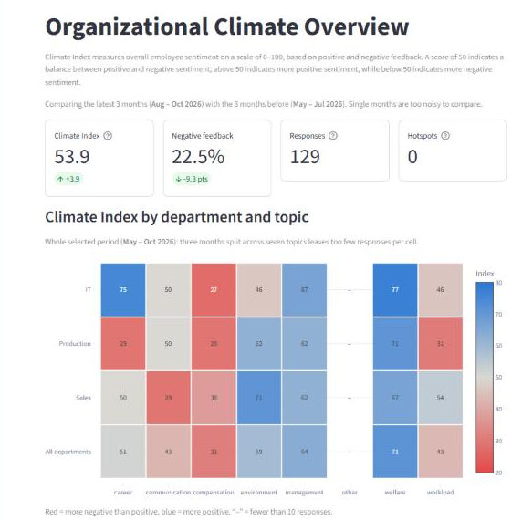
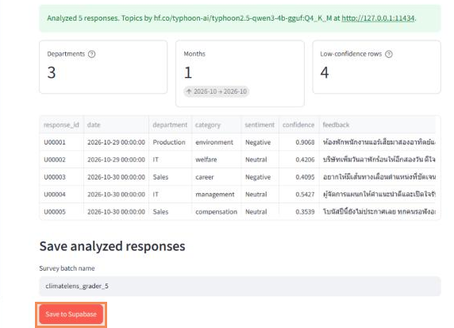

# ClimateLens

ระบบวิเคราะห์ความคิดเห็นพนักงานภาษาไทย: อัปโหลด CSV → จำแนก **ความรู้สึก** (Positive / Neutral / Negative)
→ จัด **หัวข้อ** 7 หมวดด้วย LLM ที่รันบนเครื่องเอง → แสดง **Climate Index** แยกตามหัวข้อ แผนก และเดือน

**Group 1** · 06016474 Applied AI for IT

| ชื่อ | รหัสนักศึกษา |
|---|---|
| Anawat Wongprachanukul | 66070217 |
| Amorntep Thongplum | 66070219 |
| Pubeth Sriwattana | 66070158 |
| Teerapat Tuanpromrat | 66070093 |

📄 **คู่มือฉบับเต็ม (PDF):** [docs/ClimateLens-Guide.pdf](docs/ClimateLens-Guide.pdf)

---

## 1. ทดลองบนเว็บที่ deploy แล้ว

> เว็บอยู่บน VM ของคณะ เข้าได้จาก **เครือข่ายคณะ IT / VPN ของ ITKMITL เท่านั้น**

1. เปิด **http://ito.it.kmitl.ac.th:8501** (หรือ http://10.70.38.15:8501)
2. เข้าสู่ระบบด้วยบัญชีทดลอง (Email / Password อยู่ใน **ข้อความที่ส่งใน Google Classroom**)
3. บัญชีนี้มีข้อมูลตัวอย่าง 258 ความเห็น (พ.ค.–ต.ค. 2026) ดูได้ที่หน้า Overview, Departments, Trends, Feedback Explorer

   

4. ทดลองอัปโหลด: หน้า **Upload & Analyze** → เลือกไฟล์ใน [`demo/try/`](demo/try/)
   - `climatelens_grader_5.csv`: 5 แถว (~20 วินาที)
   - `climatelens_demo_live_10.csv`: 10 แถว (~40 วินาที)
5. ตรวจผล → กด **Save to Supabase** (ไม่บังคับ)

   

## 2. รันบนเครื่องตัวเอง

ต้องมี Python 3.12 และ [Ollama](https://ollama.com/download)

1. ดาวน์โหลดโมเดลหัวข้อ (~2.5 GB):
   ```bash
   ollama pull hf.co/typhoon-ai/typhoon2.5-qwen3-4b-gguf:Q4_K_M
   ```
2. ติดตั้ง package (รันที่โฟลเดอร์หลักของโปรเจกต์):
   ```bash
   python -m venv .venv
   .venv\Scripts\activate          # Windows  (macOS/Linux: source .venv/bin/activate)
   pip install -r requirements.txt
   ```
3. คัดลอก `.streamlit/secrets.toml.example` เป็น `.streamlit/secrets.toml` แล้วใส่ `supabase_url` และ `supabase_key`
   - ใช้ฐานข้อมูลของกลุ่ม: ค่าอยู่ในข้อความที่ส่งใน Google Classroom
   - ใช้ Supabase ของตัวเอง: ทำตาม **ส่วนที่ 4** ในคู่มือ PDF (สร้างโปรเจกต์ → รัน SQL 3 ไฟล์ → สร้างผู้ใช้)
4. เปิดแอป (จากโฟลเดอร์หลัก **ไม่ใช่** `dashboard/`):
   ```bash
   python -m streamlit run dashboard/app.py
   ```
5. เปิด http://localhost:8501 แล้วเข้าสู่ระบบ

> `supabase_key` ต้องเป็น **Publishable key** (`sb_publishable_...`) เท่านั้น แอปจะปฏิเสธ Secret key

## 3. Deploy ด้วย Docker

1. สร้าง `.streamlit/secrets.toml` ตามข้อ 2.3 และเพิ่ม `ollama_host = "http://ollama:11434"`
2. รัน `docker compose up -d --build` (ครั้งแรกดาวน์โหลดโมเดล 2.5 GB)
3. เปิด `http://<server-ip>:8501`

รายละเอียด: คู่มือ PDF ส่วนที่ 5

## ผลของโมเดล

| งาน | ชุดทดสอบ | Accuracy | Macro F1 |
|---|---|---|---|
| Sentiment: char TF-IDF + Logistic Regression | Wisesight test (2,614) | 69.7% | 0.668 |
| Sentiment baseline (ตอบ Neutral ทุกแถว) | Wisesight test (2,614) | 55.6% | 0.238 |
| Topic: Typhoon 4B zero-shot (ใช้ในแอป) | ข้อสอบ 105 ข้อ (7 หมวด × 15) | 86.7% | 0.867 |
| Topic: Typhoon 4B few-shot | ข้อสอบ 105 ข้อ | 87.6% | 0.886 |

ข้อจำกัด: โมเดล Sentiment เทรนจากโซเชียลมีเดีย จึงมักอ่านความเห็นเชิงบวกในที่ทำงานเป็น Neutral (Positive F1 = 0.52)

## โครงสร้างโปรเจกต์

| โฟลเดอร์ | เนื้อหา |
|---|---|
| `dashboard/` | แอป Streamlit (`app.py` = จุดเริ่ม, `views/` = หน้าต่าง ๆ) |
| `sentiment/` | โหลดโมเดล Sentiment และบันทึกผลลง Supabase |
| `categorization/` | จัดหัวข้อด้วย Ollama, ชุดข้อสอบ 105 ข้อ, การทดลอง QLoRA |
| `models/sentiment.joblib` | โมเดล Sentiment ที่เทรนแล้ว |
| `supabase/` | SQL: `schema.sql` + `migrations/` (รันตามลำดับ) |
| `demo/` | `history/` ข้อมูลตัวอย่าง 6 เดือน, `try/` ไฟล์ทดลองอัปโหลด |
| `docs/` | คู่มือ PDF (+ LaTeX source ใน `guide/`), `README-dev.md` รายละเอียดทางเทคนิค (English) |
| `tests/` | Unit tests |

## รันเทสต์

```bash
python -m unittest discover -s tests
```
